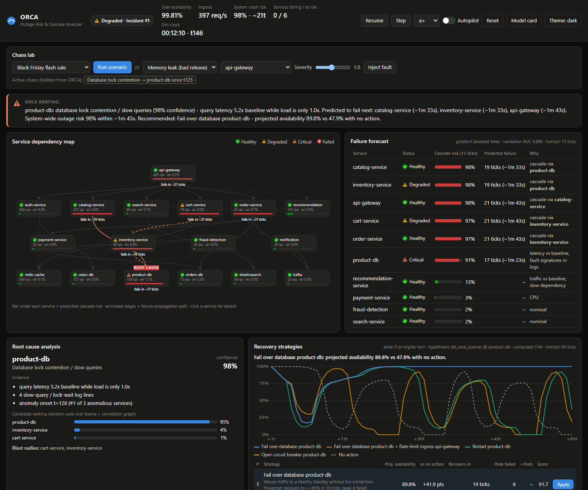

# ORCA - Outage Risk & Cascade Analyzer

**▶ [Live demo](https://2vishalv1.github.io/orca-cascade-ai/)** (runs entirely in your browser) ·
**🎬 [Demo video, 2 min](https://2vishalv1.github.io/orca-cascade-ai/media/orca-demo.mp4)** ·
**📄 [Submission details](SUBMISSION.md)** ·
[](https://github.com/2ViShAlv1/orca-cascade-ai/actions/workflows/deploy.yml)

> **Problem statement 01 | Software & AI** - Build an AI system that predicts cascading software failures,
> identifies their root causes and recommends the optimal recovery strategy *before* an entire system crashes.
> Analyse simulated server logs and service dependencies, trace how failures could spread, and compare recovery
> strategies through a live dashboard.

ORCA watches a 17-service e-commerce platform through the same signals an SRE has (metrics, raw log lines,
deploy/crash events). It **predicts which services will fail ~70 s before they do**, **names the root cause and
fault type**, **simulates every recovery option on a digital twin** and applies the best one (or hands it to you
with one click), then **writes the post-mortem**.


*All services still green - ORCA has already named `product-db` (98% confidence), predicts an outage in ~1m43s
and has the fix ranked.* More: [outage view (light theme)](docs/screenshots/dashboard-outage-light.png) ·
[post-mortem](docs/screenshots/post-mortem.png) · [model card](docs/screenshots/model-card.png).

**Zero third-party dependencies** - Python 3.10+ standard library and a vanilla-JS dashboard. Nothing to install.
The [live demo](https://2vishalv1.github.io/orca-cascade-ai/) needs no server at all: the dashboard boots the same
Python package in the browser with Pyodide (CPython on WebAssembly).

```bash
python run.py                    # then open http://127.0.0.1:8000
# or: start.bat (Windows) | ./start.sh (macOS/Linux) | docker build -t orca . && docker run -p 8000:8000 orca
```

---

## Results (held-out evaluation)

60 chaos episodes (10 per fault type, random targets and severities, seeds disjoint from training) plus
fault-free runs - full report in [`reports/evaluation.md`](reports/evaluation.md), reproducible with
`python -m orca.evaluate`.

| | |
|---|---|
| Failures predicted **before** they happened | **92%**, on average **14 ticks (~70 s)** early |
| Precision of risk flags | **81%** - and **0 false alarms** on fault-free runs |
| Root cause - service (top-1) / fault type | **100% / 100%** |
| User availability, no action → **ORCA autopilot** | **72.3% → 93.5%** |
| ORCA's first recommendation vs textbook expert fix | **92.4%** vs 91.9% |
| Failure model | gradient-boosted trees, **AUC 0.889** (logistic-regression baseline 0.782), 136k samples |

| Fault | Predicted | RCA top-1 | Fault type | Availability: no action → ORCA autopilot |
|---|---|---|---|---|
| Memory leak (bad release) | 94% | 100% | 100% | 96% → **100%** |
| Traffic surge (2.2× flash sale) | 94% | 100% | 100% | 40% → **69%** (excess traffic must be shed: databases cannot scale out) |
| Database lock contention | 87% | 100% | 100% | 64% → **95%** |
| Cache memory exhaustion | 95% | 100% | 100% | 61% → **100%** |
| Faulty deployment | 94% | 100% | 100% | 82% → **99%** |
| Disk filling up | 87% | 100% | 100% | 91% → **100%** |

---

## The dashboard

| Panel | What it does |
|---|---|
| **ORCA briefing** | One live paragraph, like an on-call engineer would write it: what is wrong, how sure ORCA is, what fails next and when, what to do. |
| **Service dependency map** | Status of all 17 services (icon + label, never colour alone), predicted cascade-risk bar per node, animated failure-propagation path, *ROOT CAUSE* tag and *fails in ~N ticks* countdowns. |
| **Failure forecast** | Every service ranked by probability of failing within 15 ticks (75 s), ETA and the model's reasons (or *cascade via X*). |
| **Root cause analysis** | Root service + fault type + confidence, human-readable evidence, candidate ranking, blast radius. |
| **Recovery strategies** | 5-12 candidate strategies simulated 60 ticks ahead on a digital twin: projected availability curves, time to recover, peak failures, extra pods, risk-adjusted score, one-click **Apply**. |
| **User availability** | Live availability with chaos/action/crash markers; incident history with prediction lead time and a **Post-mortem** button (rendered report + Markdown download). |
| **Live logs / Event timeline** | The raw log stream ORCA parses (blamed services highlighted) and every chaos, action, crash, escalation and incident event. |
| **Chaos lab** | Seven one-click scenarios or any fault × target × severity. **Autopilot** lets ORCA remediate on its own. |
| **Model card** | Model quality and the held-out evaluation, live in the UI. |

Click any service for telemetry sparklines, anomalous signals, **why ORCA thinks it may fail** (per-feature
contributions) and manual remediation buttons. **Theme** toggles light/dark (light works best on projectors).
Deep links: `/?show=model`, `/?show=incident-1`, `/?open=product-db`, `/?theme=light`.

### 3-minute demo script
1. **Calm** (10 s): everything green, crash risk ~0% - no false alarms.
2. **Chaos lab → Product DB lock storm → Run scenario.** Within a few ticks the forecast flags `product-db`,
   `inventory-service`, `catalog-service` and the gateway with *fails in ~20 ticks*. The briefing and RCA name
   `product-db` / *database lock contention* from slow-query logs and timeout blame pointers.
3. **Recovery strategies**: *Fail over database* projects ~88% availability vs ~35% with no action - click
   **Apply** and watch the map turn green.
4. Open **Post-mortem** on the incident - timeline, lead time per service, evidence, actions, prevention.
5. **Reset → Autopilot on → Leaky catalog release.** ORCA rolls the release back while the heap is at ~60%:
   zero services fail.
6. Optional: **Black Friday flash sale** with autopilot - ORCA caps ingress and scales the three hottest tiers;
   no service fails while the surge lasts.

---

## How it works

```
 simulated estate (digital twin)          observer                 AI layer                        actions
 ┌──────────────────────────────┐  metrics ┌───────────────┐ feat. ┌───────────────────────────┐  plan ┌──────────────┐
 │ 17 services, 24 dependencies │────────▶ │ EWMA baselines│──────▶│ GBDT failure predictor    │──────▶│ what-if sims │
 │ queueing, pools, timeouts,   │  logs    │ z-score anom. │       │ + trend hazard (hybrid)   │       │ on a forked  │
 │ retries, cache misses, OOM,  │────────▶ │ log templates │       │ noisy-OR cascade on graph │       │ twin, ranked │
 │ liveness kills, chaos faults │  events  │ blame graph   │──────▶│ random-walk RCA + fault   │──────▶│ → Apply /    │
 └──────────────────────────────┘────────▶ └───────────────┘       │ signature classifier      │       │   Autopilot  │
            ▲                                                       └───────────────────────────┘       └──────┬───────┘
            └──────────────────────── remediation (rollback, failover, rate-limit, scale, flush keys…) ◀──────┘
```

### 1. Simulated estate - `orca/simulator.py`, `orca/topology.py`
Discrete-time model (1 tick = 5 s) in which cascades **emerge from physics, not scripts**: queueing latency
grows non-linearly with utilisation; in-flight requests = rps × latency (Little's law), so a slow dependency
exhausts its callers' worker/connection pools; latency beyond a client timeout becomes errors; callers retry and
amplify load on a sick service; a cold or evicting cache multiplies database load; OOM and failed liveness probes
cause crash loops. Each service reads its dependencies' *previous* tick, so failures travel hop by hop - which is
what makes them predictable. It emits realistic raw log lines (`Timeout after 2000ms waiting for response from
product-db`, `OOMKilled…`, `Slow query (4120ms)… waiting for ShareLock`, `No space left on device`) and change events.

Six chaos faults with gradual, realistic onsets: memory leak in a release, traffic surge, database lock contention,
cache memory exhaustion (evictions → thundering herd → OOM), faulty deployment (canary → full rollout), disk
exhaustion. Eight remediations with realistic delays, side effects and risk: restart, scale out, rollback, circuit
breaker, adaptive rate limit, DB failover, flush oversized cache keys, purge/expand storage.

**ORCA never reads the injected ground truth** - only metrics, logs and change events.

### 2. Observation - `orca/observer.py`, `orca/logparse.py`
Adaptive per-metric EWMA baselines (frozen while anything is anomalous, so a long incident never becomes "the new
normal"), robust z-scores and anomaly onset tracking. **Log template mining** maps each raw line to a template,
marks it *intrinsic* (OOM, slow query, exception after deploy, disk full, ingress surge) or *symptom*, and extracts
**blame pointers** from dependency errors. 22 features per service: levels and slopes of error, latency, CPU,
memory and pool saturation, time-to-exhaustion of memory/disk, traffic ratio, cache hit drop, log rates,
dependency health, recent crashes.

### 3. Prediction - `orca/predictor.py`, `orca/train.py`
* **Gradient-boosted decision trees** (pure Python, histogram splits) predict *"this service crosses the failure
  threshold within 15 ticks"*, trained on 240 simulated incident histories. Calm samples are subsampled and
  re-weighted, so probabilities stay calibrated.
* **Explainable**: exact per-feature contributions via tree-path (Saabas) attribution, shown as *why ORCA thinks it
  may fail*.
* **Hybrid trend hazard**: monotone resource exhaustion (heap, disk) is also extrapolated deterministically.
* **Cascade risk**: risks propagate up the dependency graph with a noisy-OR model (hard vs soft dependencies, noise
  floor), producing multi-hop risk, the propagation path, cascade ETAs and a *system crash risk*.
* Alert threshold 0.6 chosen by a sweep (0.5: 95% recall / 72% precision; **0.6: 93% / 79%**; 0.7: 86% / 86% with
  less warning time).

### 4. Root-cause analysis - `orca/rca.py`
**Random walk with restart** (personalised PageRank, as in MicroRCA) over the anomaly subgraph: the walker moves
from symptoms towards causes along dependencies, weighted by log blame pointers and anomaly-series correlation, and
stays put in proportion to a node's intrinsic evidence; earlier onset and a recent deploy raise the score. A
signature classifier labels the fault type and every conclusion carries evidence. Independent secondary signatures
(e.g. a surge on top of DB contention) are reported too.

### 5. Recovery planning - `orca/recovery.py`
Rebuilds **every diagnosed fault** (not the ground truth) on a fork of the live operational state, calibrated to
observed trends, generates candidate strategies for the diagnosis and its secondary faults, and simulates each one
60 ticks forward. Score = 100 × (0.6·mean + 0.4·final availability) − 1.5·mean failed services − 0.4·extra pods −
3·action risk.

**Autopilot guardrails**: acts early when confident (≥70%) and the win is large, or when failure is imminent;
never offers a circuit breaker on a healthy service; never repeats an action on the same target within 60 ticks -
if a remediation did not work, ORCA's model of the incident is wrong, so it **escalates to on-call** instead of looping.

### 6. Engine, reports and dashboard - `orca/engine.py`, `orca/report.py`, `orca/server.py`, `web/`
Each tick: simulate → ingest → predict → RCA → re-plan (every 3 ticks during an incident) → autopilot → publish over
Server-Sent Events. Incidents record lead times per service, impact (error budget consumed), the diagnosis frozen at
decision time, actions with their projected outcomes, and escalations; `report.py` turns them into the briefing and
the post-mortem.

---

## Engineering quality
* **20 unit + integration tests** (`python -m unittest discover -s tests`): simulator physics, log parsing, model
  maths (GBDT attributions sum exactly to the margin), end-to-end prediction → RCA → plan, autopilot guardrails,
  adaptive rate limiter, multi-fault twin, engine commands.
* CI (GitHub Actions) runs the tests on Python 3.10 and 3.12 and deploys the live site; also verified on 3.14.
* Refuses to start a second server on a port already in use (Windows would otherwise silently share it).

## Project layout
```
run.py / start.bat / start.sh / Dockerfile     launchers
orca/topology.py      services and dependency graph
orca/simulator.py     estate simulator / digital twin, chaos faults, remediations, raw logs
orca/logparse.py      log template mining, blame pointers
orca/observer.py      baselines, anomaly detection, features, trend ETAs
orca/predictor.py     GBDT + logistic models, explanations, cascade propagation
orca/rca.py           random-walk root-cause analysis + fault signatures
orca/recovery.py      what-if recovery planner + autopilot policy
orca/engine.py        analysis pipeline, live engine, incidents, autopilot
orca/report.py        live briefing + incident post-mortems
orca/server.py        HTTP + SSE server (stdlib)
orca/api.py           API routing shared by the server and the in-browser (Pyodide) runtime
orca/train.py         model training on simulated incidents
orca/evaluate.py      held-out evaluation → reports/evaluation.{md,json}
orca/scenarios.py     chaos presets and random episodes
web/                  dashboard (index.html, app.js, backend.js, style.css)
tools/build_site.py   builds the server-less GitHub Pages site (_site/)
models/predictor.json trained model      reports/   evaluation + training logs
tests/test_orca.py    test suite         docs/PITCH.md   pitch + demo + Q&A notes
```

## Commands
```
python run.py [--port 8000] [--seed 7] [--interval 1.0]   # live dashboard
python -m orca.train --episodes 240                       # retrain the failure model (~4.5 min)
python -m orca.evaluate --per-kind 10 --calm 6            # held-out evaluation (~4 min)
python -m unittest discover -s tests                      # tests (~1 s)
```
API: `GET /api/meta | /api/state | /api/stream (SSE) | /api/postmortem?id=N | /api/evaluation`,
`POST /api/inject {kind,target,severity} | /api/scenario {id} | /api/strategy {id} | /api/action {kind,target} |
/api/control {paused|speed|autopilot|step|reset}`.

## Limitations and next steps
* The estate is simulated. In production the observer would ingest Prometheus/OpenTelemetry metrics, a log pipeline
  (Loki/ELK) and the Kubernetes/deploy event stream, with the topology discovered from distributed traces.
* The twin's physics are hand-calibrated; with real data they would be fitted from traces (capacity, latency
  curves, retry policies) and the predictor fine-tuned on real incident history.
* Compound incidents (e.g. a surge during DB contention) are the hardest case: ORCA improves them but may escalate
  to a human - by design.
* Natural extensions: an LLM to converse about the evidence chain, and integration with paging (PagerDuty/Slack).
